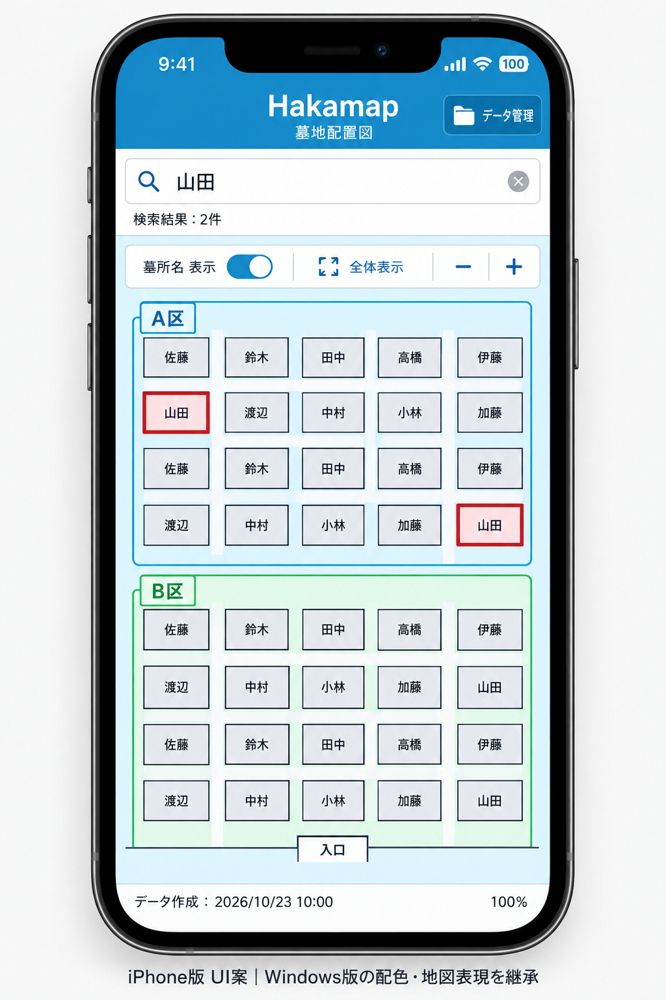

# iPhone版の画面構成案

更新日: 2026-10-23

## 合意した方向性

Windows版と大きく異なるUIにはせず、既存の青いヘッダー、白い操作パネル、
空色の地図背景、赤い検索対象強調を引き継ぐ。
初期版はiPhoneの縦向きに対応する。

- 上部にヘッダーと検索欄を配置する。
- ヘッダー右上に「データ管理」を配置する。
- 検索欄の下に検索結果件数を表示する。
- 検索欄の近くに「すべて」「墓所名・家名」「人物の氏名」の対象選択プルダウンを置く。
  初期値は「すべて」。対象変更時は入力済みキーワードで検索結果を更新する。
- 配置図の上部に、名前・家名の表示切替、全体表示、拡大・縮小をまとめる。
- 中央の主要領域を配置図とし、指による移動と拡大・縮小に対応する。
- 下部に取り込んだデータの作成日時を表示する。

## データ管理画面

ヘッダー右上の「データ管理」から開く。
「データを取り込む」ボタンと、取り込み済みデータの作成日時を表示する構成で合意済み。
データ更新前には既存データの置き換えを確認し、取り込みに失敗した場合は既存データを保持する。

取り込み手順は次の流れで合意済み。

1. 「データを取り込む」を押す。
2. iPhoneの「ファイル」から取り込み対象を選択する。
3. 既存データがある場合は、置き換えを確認する。
4. 取り込みが成功したら、完了を案内する。

LINEで受け取ったファイルは、いったん「ファイル」に保存してから選択する。
ファイル選択や置き換え確認をキャンセルした場合は、既存データを変更しない。

## イメージ図

利用者が画面の方向性を確認した概念図であり、実装済み画面ではない。
配置図、名前、日時、倍率はサンプル。画像内の検索一致件数や強調箇所の対応は
仕様の正とせず、検索条件に一致するすべてのお墓を強調する要件に従う。
余白、寸法、細かな表示は実装前に調整する。
画像は対象選択プルダウンを追加する前の案であり、最新の画面構成は本文を正とする。

機能と振る舞いは[要件整理](../requirements/iphone.md)、配色は
[Windows版UI設計](frontend-ui.md)を参照する。
